<h1>
  <picture>
    <source media="(prefers-color-scheme: dark)" srcset="assets/logo-dark.svg">
    
  </picture>
</h1>

**La veille financière et économique mondiale, dans une interface de plateforme professionnelle, mise à jour en continu.**

Un projet étudiant, conçu et développé par **Yassine Zouhair**.

FinVeille rassemble l'actualité de 43 flux RSS et de 4 API financières, la classe par rubrique, suit les
entreprises et les thèmes de son utilisateur, affiche les cours des marchés mondiaux et résume les articles par IA.
Application web en Python (Streamlit), construite pas à pas : chaque étape est un commit, documenté dans
[`guide/`](guide/README.md).

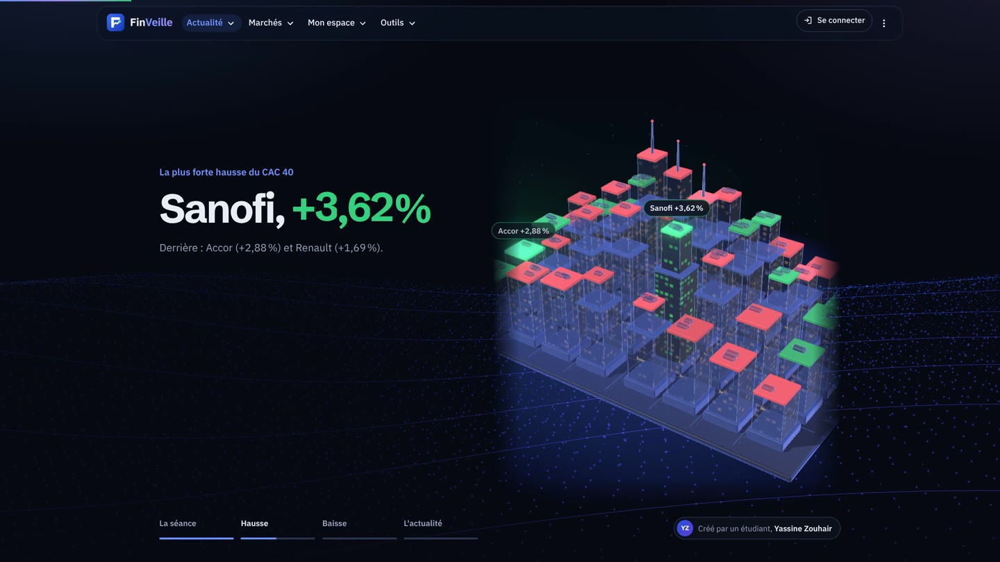

[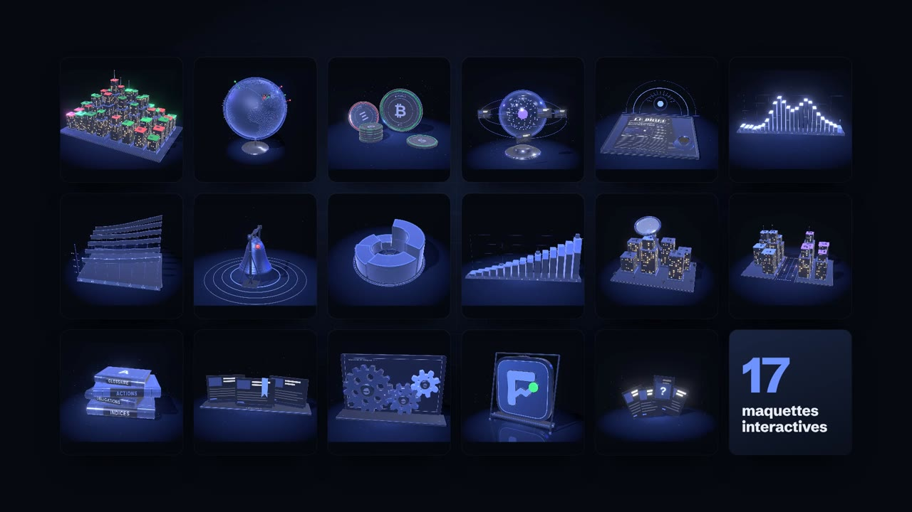](docs/branding/trailer.mp4)

▶ [Voir la bande-annonce (53 s)](docs/branding/trailer.mp4) : on appuie sur le logo, l'application s'ouvre, et tout défile : l'actualité de toutes les rubriques réunie en un seul fil, les marchés en direct et la carte du CAC 40, l'économie et la crypto, les questions avec leurs sources, les alertes, le portefeuille virtuel, le site sur ordinateur et sur téléphone. Musique « Expressive Courage » (Mixkit), animation faite par le code (guide 37). [Démonstration des transitions (29 s)](docs/branding/demo.mp4)

## Fonctionnalités

| | |
| --- | --- |
| **Agrégation** | 43 flux RSS gratuits rangés par région : France (Le Figaro, La Tribune, BFM Business, AMF…), Canada (Radio-Canada, La Presse, The Globe and Mail, Banque du Canada…), Monde (MarketWatch, Financial Times, The Guardian, The Block…) + Finnhub, NewsAPI, Marketaux et Alpha Vantage si les clés sont renseignées. Téléchargement en parallèle, dédoublonnage. |
| **Le fil** | En haut de l'accueil, **la séance racontée au défilement**, en quatre chapitres que la maquette 3D du CAC 40 joue : le CAC 40, sa plus forte hausse, sa plus forte baisse (la caméra file vers leur tour), l'histoire du jour (guide 32). Puis une mise en page de journal : « À la une » en grand avec sa photo, trois vignettes, puis « En continu ». Une image seulement si c'est la vraie (la photo de partage de l'article) ; sans photo, l'article passe en version texte, avec le liseré de couleur de sa rubrique. L'histoire à la une est celle reprise par le plus de sources ; rubriques Marchés / Crypto / Entreprises / Macro (classement par mots-clés), tendances cliquables, filtre par source, recherche avancée (`"expression exacte"`, `-exclure`, `source:cnbc`), vue compacte, mise à jour automatique toutes les 5 minutes. |
| **Assistant IA** | Des questions en français sur l'actualité, les marchés ou un terme financier ; des réponses rédigées par Gemini ou Groq (gratuits) **à partir des dépêches du moment**, qui citent leurs sources [1], [2]… (recherche par pertinence avec traductions français → anglais, puis génération : « RAG »). Réponse affichée au fil de l'eau, conversation suivie. Également : analyse pédagogique des fiches entreprises, édito du brief rédigé chaque heure. Sans clé : définitions du glossaire et dépêches pertinentes. Quotas, limiteur et mémoire partagée pour tenir la charge. |
| **Le brief** | L'édition du jour rédigée automatiquement : la séance en une phrase, l'histoire la plus reprise de chaque rubrique, les sujets qui montent, l'agenda de mes entreprises, le mot du jour. Téléchargeable en Markdown, **envoyé par e-mail chaque matin** aux abonnés. |
| **Comptes** | Inscription par e-mail et mot de passe (empreinte scrypt, blocage anti-force brute, code de confirmation, mot de passe oublié, connexion qui dure 30 jours), ou connexion avec Google, Facebook et autres comptes (OpenID Connect). Assistant de configuration pour l'administrateur. Chaque utilisateur a ses propres favoris, suivis, portefeuille et alertes ; export et suppression de ses données (RGPD). Sans configuration, mode local à un utilisateur. |
| **Tenir la charge** | Mesuré avec un test de charge maison (visiteurs virtuels WebSocket) et un profileur : 200 visiteurs arrivés ensemble tous servis en 11 s, 300 visiteurs étalés sur 30 s servis en 0,12 s (médiane), contre des connexions coupées dès 100 visiteurs au départ. File d'attente d'affichage, calculs partagés entre visiteurs, caches et mémoires bornés, dernières données valides si une source tombe, réglages de production. Image Docker ; mise en ligne gratuite sur Streamlit Community Cloud directement depuis le dépôt (guide 25). |
| **Base de données** | SQLite en local ; en ligne, PostgreSQL gratuit (Neon, Supabase) en une ligne de secrets, pour que les comptes survivent aux redémarrages. Mêmes requêtes SQL pour les deux, réserve de connexions, tests exécutés sur les deux bases. |
| **Favoris, lu, masqué** | Enregistrés dans une base SQLite, conservés d'une session à l'autre ; notes personnelles ; export CSV des favoris. |
| **Mes suivis** | Entreprises (recherche par nom) et thèmes, avec un fil dédié pour chacun. |
| **Fiches entreprises** | Logo, cours, graphique interactif (1 mois à 5 ans) avec les dépêches placées sur la courbe, 10 indicateurs clés expliqués (PER, VE/EBITDA, ROE, rendement, bêta…), fourchette sur 52 semaines, agenda (résultats, dividende, consensus). |
| **Fiches des valeurs** | Une fiche pour chaque action, indice, devise et crypto, ouverte d'un clic depuis tuile, carte, classement ou bandeau : cours, graphique, résultats, analystes, dividendes, actualités (guide 38). |
| **Marchés par place** | France (CAC 40), Canada (S&P/TSX 60), États-Unis (Dow Jones) et monde, chacun avec sa carte par secteur et ses palmarès (guide 38). |
| **Marchés** | Bandeau défilant des cours sur toutes les pages ; 20 instruments mondiaux avec mini-courbes et carte des performances ; carte du CAC 40 par secteur (40 valeurs, palmarès) ; convertisseur de devises. |
| **Économie** | Tableau de bord des statistiques officielles (BCE, Réserve fédérale) : inflation et inflation sous-jacente, taux directeurs et taux réels, taux à 10 ans, chômage, croissance, pour la zone euro, la France et les États-Unis ; courbes des taux avec détection d'inversion. |
| **Crypto** | Les 20 premières cryptomonnaies en euros (CoinGecko) avec variations et mini-courbes, capitalisation totale, dominance du bitcoin, indice « peur et avidité » sur un an, dépêches crypto. |
| **Comparer** | Jusqu'à 4 entreprises en base 100, rendement annualisé, volatilité, perte maximale, valorisation, matrice de corrélation et **frontière efficiente** de Markowitz (4 000 répartitions simulées, portefeuilles de variance minimale et de Sharpe maximal). |
| **Portefeuille virtuel** | Positions multidevises valorisées en euros, plus-values latentes, répartition, performance comparée au CAC 40, portefeuille d'exemple. |
| **Simulateurs** | Épargne à intérêts composés (frais, règle de 72), investissement programmé rejoué sur l'historique réel d'un indice ou d'une action, crédit immobilier (mensualité, amortissement, taux d'endettement, capacité d'emprunt à 35 %), inflation et rendement réel. |
| **Alertes** | Seuils de cours ou de variation du jour, bandeau d'alerte sur toutes les pages, **e-mail** dès qu'une alerte se déclenche (une fois par jour au plus). Envois par une tâche planifiée GitHub Actions et SMTP (Gmail, Brevo). |
| **Quiz** | 10 questions tirées du glossaire (pièges de la même rubrique), correction détaillée, meilleur score enregistré dans le compte. |
| **Glossaire** | 55 termes de la finance expliqués simplement, recherche, mot du jour. |
| **En chiffres** | Tableau de bord du flux : dépêches par heure et par rubrique, entreprises les plus citées, tonalité par rubrique. |
| **Résumé par IA** | « L'essentiel » en 3 points : Gemini ou Groq (offres gratuites) en français, ou résumé extractif local sans clé ; repli automatique en cas d'erreur, résumés mis en cache. |
| **Design** | **Une maquette 3D dans chaque page** (Three.js, WebGL) : la ville du CAC 40 dans le récit de l'accueil (une tour par valeur, façades aux fenêtres allumées, toit à la couleur de la séance), un globe de bureau sur Marchés (une épingle lumineuse par place, des arcs depuis Paris), des pièces frappées sur Crypto, la sphère de l'assistant et ses sources, et un objet par page d'outil. Faites de la matière du site (verre sombre, arêtes de lumière, données en lumière), avec un halo lumineux ; on les survole (nom et chiffre), on les fait tourner, et **chacune sert à quelque chose au clic** : une tour du CAC 40 cherche ses dépêches dans le fil, une épingle du globe montre la tuile de son indice, une pièce sa ligne du classement, une fiche de l'assistant pose sa question, un livre du glossaire cherche son sujet, la cloche sonne et mène au formulaire d'alerte (guide 33). Derrière, une ambiance de particules qui se reforment d'une page à l'autre (guide 30). Direction artistique « terminal de nuit » : la ligne de cours du logo en travers de chaque en-tête, une illustration dessinée par page, transitions entre les pages et au défilement (coupées si l'on préfère moins de mouvement). Animations GSAP tirées de la Bourse : cours qui arrivent en rouleaux comme sur un tableau de cotation, dépêches qui s'impriment, horloges des places en direct (guide 32). Système de design en jetons à trois niveaux (primitifs → sémantiques → composants), thèmes clair et sombre (bleu nuit) avec `light-dark()` en CSS, en-têtes « héros » dans le style des visuels de la marque (grand titre en Schibsted Grotesk, cours en tuiles flottantes), squelette de chargement, tuiles de cours colorées par tendance, cartes en relief, composants communs (boutons, champs, sélecteurs). Graphiques à palette validée pour le daltonisme, étiquettes directes au bout des courbes. Accessibilité mesurée par un audit automatique de toutes les pages (`tools/ux_audit.py`). Contrastes AA mesurés, cibles tactiles de 44 px, animations coupées si l'on préfère moins de mouvement, couleurs adaptées au daltonisme. [Charte de marque](docs/brand-guidelines.md) et visuels pour LinkedIn et GitHub (guide 26). |

## Aperçu

| Le fil (thème sombre) | Le brief du jour |
| --- | --- |
| 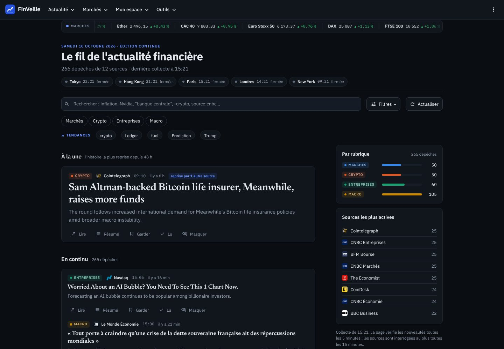 | 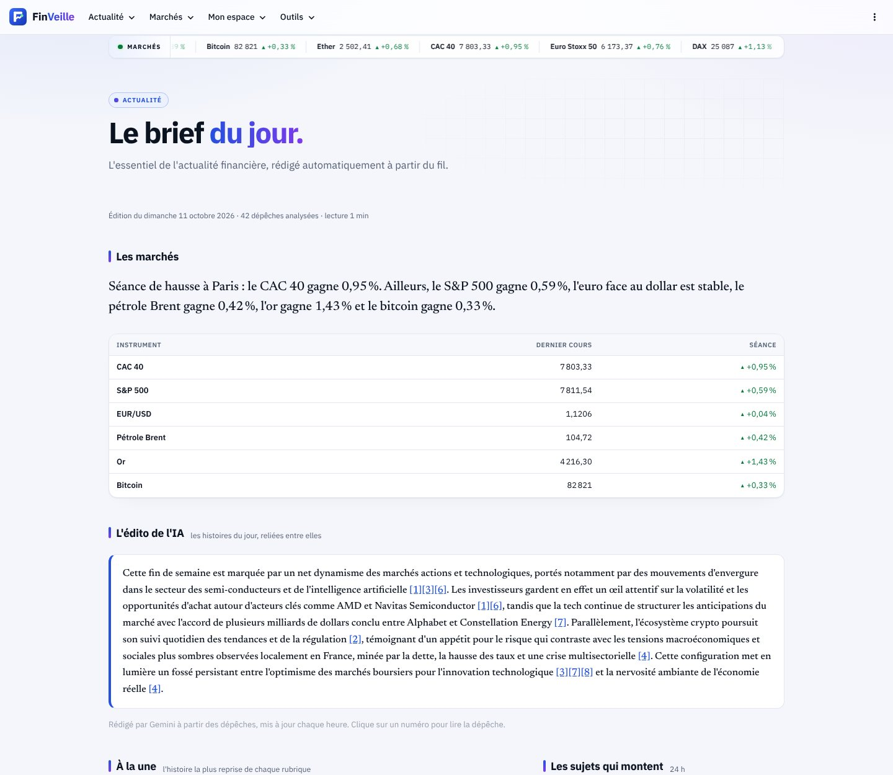 |
| **Économie (BCE, Fed)** | **Crypto** |
| 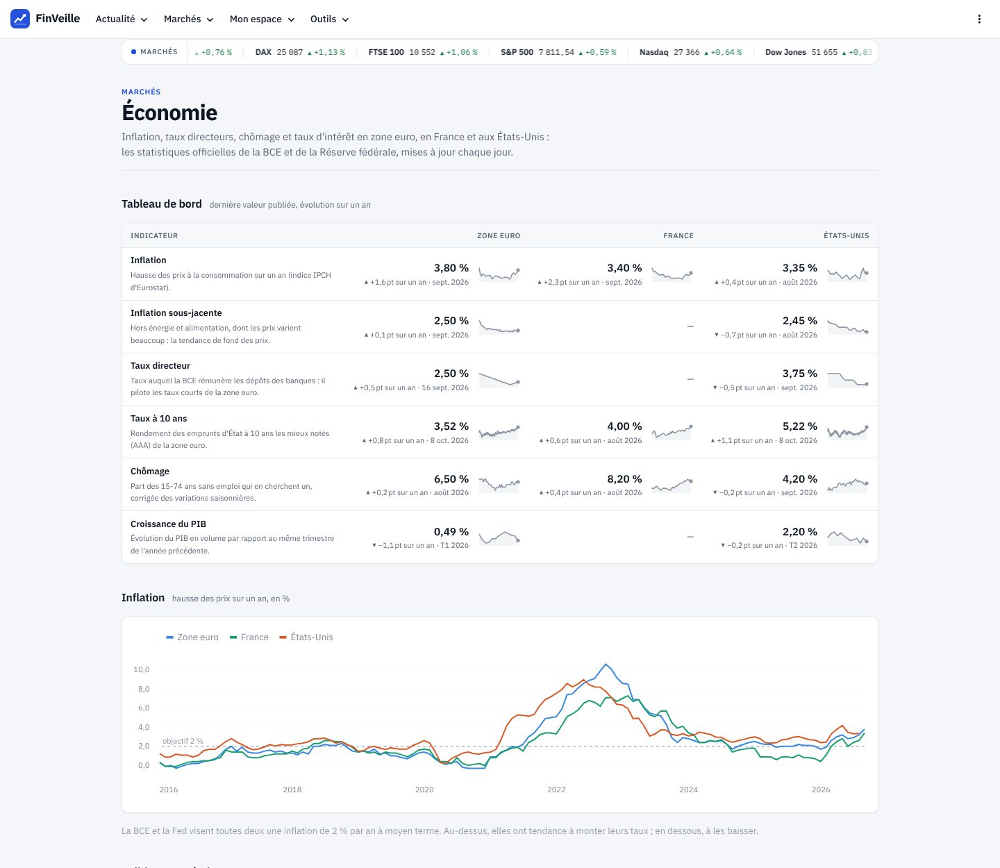 | 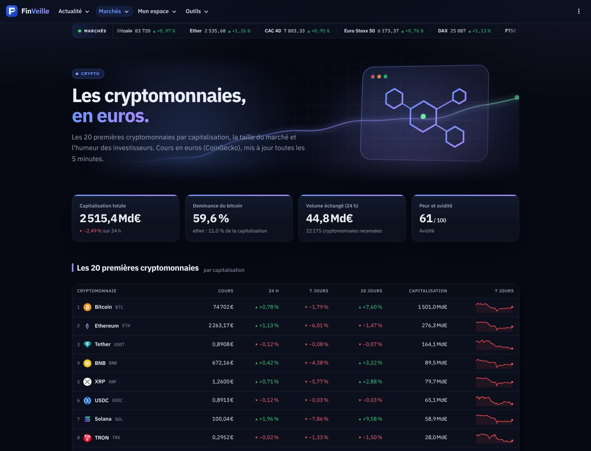 |
| **Carte du CAC 40** | **Frontière efficiente** |
| 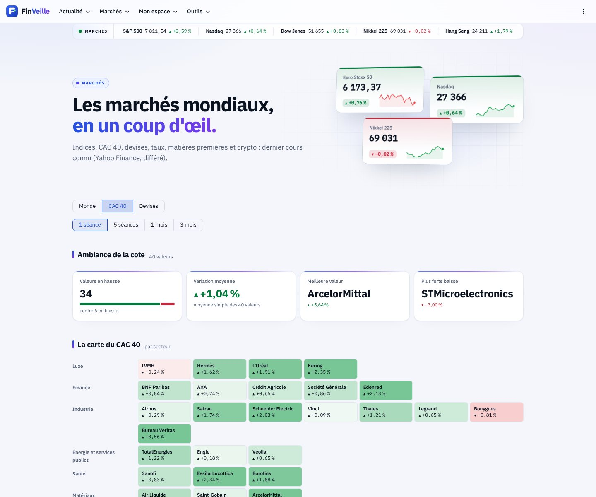 | 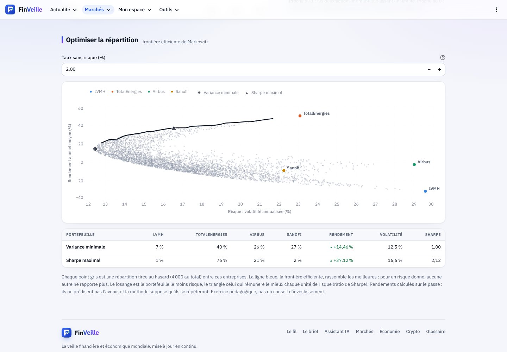 |
| **Simulateur d'investissement programmé** | **Portefeuille virtuel** |
| 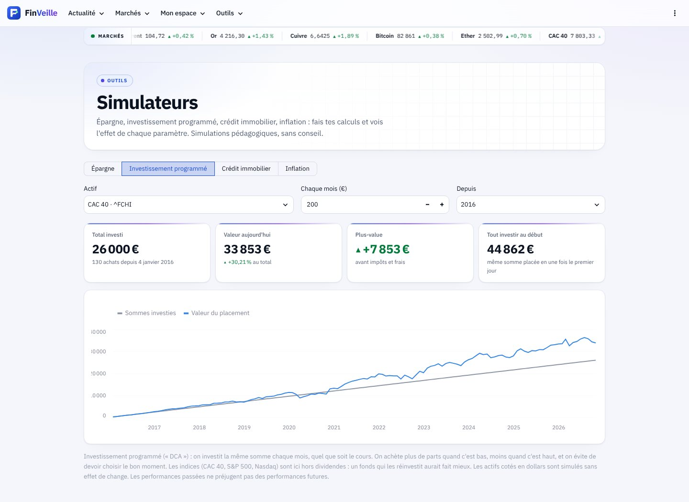 | 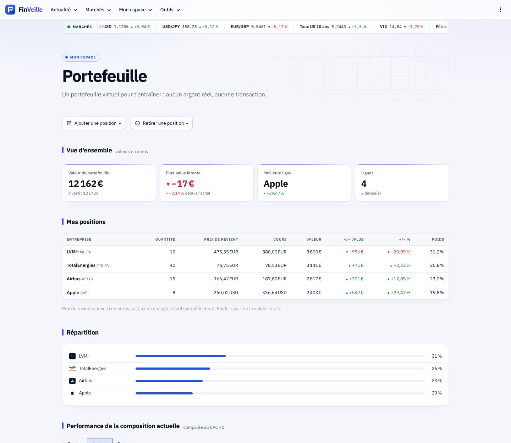 |
| **Fiche entreprise** | **Mobile** |
| 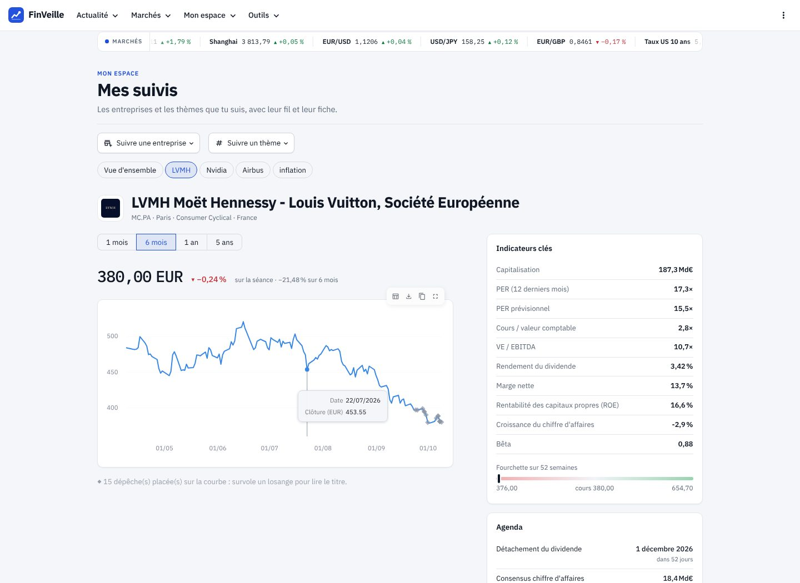 | 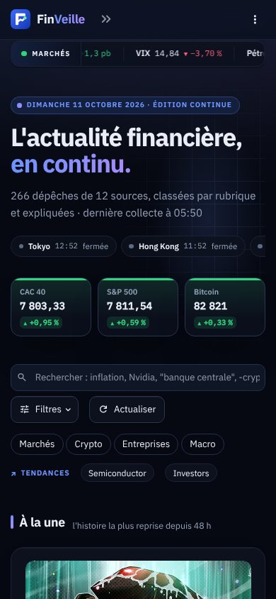 |
| **Connexion (e-mail, Google, autres comptes)** | |
| 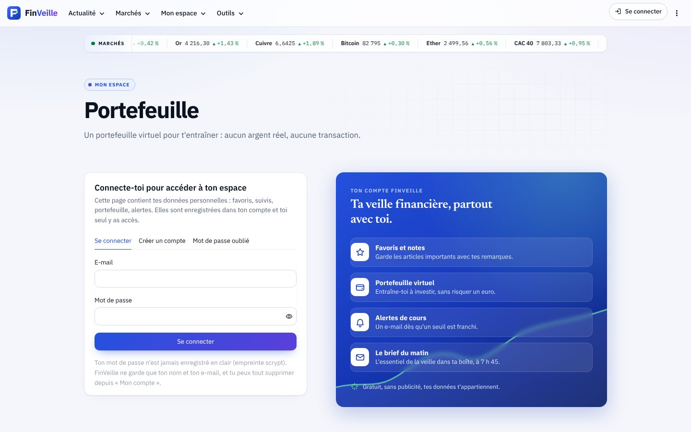 | |

## Architecture

```
 Navigateur (ordinateur / mobile)
        │
 ┌──────▼─────────────────────────────────────────────────────────────┐
 │ Interface Streamlit   app.py · views/*.py · ui.py · theme.py         │
 └──────┬─────────────────────────────────────────────────────────────┘
        │ appelle                                   (aucun code Streamlit en dessous)
 ┌──────▼─────────────────────────────────────────────────────────────┐
 │ core/  sources → aggregator → classifier · filters · analytics       │
 │        market · summarizer · storage                                 │
 └──┬──────────────────┬──────────────────┬──────────────────┬───────┘
    ▼                  ▼                  ▼                  ▼
 RSS, Finnhub,     Yahoo Finance,     Gemini / Groq     SQLite (local) ou
 NewsAPI, Marketaux, BCE, FRED,       (résumés)         PostgreSQL (en ligne)
 Alpha Vantage     CoinGecko
```

- **Logique et affichage séparés :** `core/` ne dépend pas de Streamlit. Tout y est testable sans navigateur.
- **Un format unique :** chaque source est convertie en `Article` dès la réception.
- **Robustesse :** une source en panne n'arrête jamais l'application ; les erreurs affichées ne révèlent jamais une
  clé API.
- **Sobriété :** caches calibrés sur les quotas gratuits (15 min pour les actualités, 2 min pour les cours, 6 h pour
  les fiches), résumés calculés une seule fois.

## Stack

Python 3.11+ · Streamlit (+ OpenID Connect) · requests · feedparser · yfinance · pandas · NumPy · Altair · trafilatura ·
SQLite / PostgreSQL (psycopg) · pytest

38 étapes documentées dans [`guide/`](guide/README.md), une par commit.

## Lancer le projet

```bash
git clone <adresse-du-dépôt> && cd finveille
python -m venv .venv
source .venv/bin/activate            # Windows : .venv\Scripts\Activate.ps1
pip install -r requirements.txt
streamlit run app.py
```

L'application fonctionne **sans aucune clé**. Pour activer les API et l'IA, copie
`.streamlit/secrets.toml.example` en `.streamlit/secrets.toml` et renseigne les clés gratuites voulues.
Pour développer avec rechargement automatique à chaque modification du code :
`streamlit run app.py --server.fileWatcherType auto` (désactivé par défaut : réglage de production, guide 25).

Avec Docker (le même environnement partout, guide 25) :

```bash
docker build -t finveille .
docker run -p 8501:8501 finveille                 # → http://localhost:8501
```

Tests :

```bash
pip install -r requirements-dev.txt
pytest
```

## Structure

```
app.py            point d'entrée : thème, bandeau des cours, navigation
art.py            direction artistique : ligne de cours signature, illustrations des pages (SVG)
ui.py             éléments partagés : chargement en cache, carte d'article, résumé
theme.py          design : jetons de couleur clair/sombre, cartes, tuiles, tableaux, mise en forme française
assets/           le logo (SVG) : symbole, versions claire et sombre
views/            une page par fichier (fil, brief, assistant IA, en chiffres, marchés, économie, crypto, comparer,
                  suivis, portefeuille, alertes, favoris, simulateurs, quiz, glossaire, réglages, compte, configuration)
core/             logique métier : sources, agrégation, classement, statistiques, marché, indicateurs de
                  risque, portefeuille, alertes, brief, économie (BCE, FRED), crypto, simulateurs, quiz, résumé,
                  assistant IA, images, comptes, e-mails, stockage, tenue de charge
tests/            257 tests pytest, rejoués aussi sur PostgreSQL si une base de test est fournie (sources, recherche,
                  base et comptes, IA, tenue de charge, indicateurs, portefeuille, alertes, brief, chaque page)
scripts/          tâche planifiée : envoi du brief et des alertes par e-mail
tools/            test de charge, audit d'accessibilité, générateur du logo
deploy/           démarrage du conteneur Docker, fiche du Space Hugging Face
docs/             charte de marque, captures d'écran, visuels (bannière LinkedIn, aperçu GitHub)
guide/            le guide de construction, étape par étape
```

## Choix de conception

- **Un design de plateforme financière** : barre d'application avec logo, cartes, tableaux, chiffres en police à
  chasse fixe, une seule couleur de marque (le bleu). Interface en IBM Plex Sans, titres d'articles en Newsreader
  pour garder une touche éditoriale. La couleur des données est réservée à la hausse, la baisse et aux rubriques.
- **Deux vraies palettes** : Streamlit indique le thème actif au navigateur (`color-scheme`), la fonction CSS
  `light-dark()` choisit la bonne couleur sans relancer le script.
- **Accessibilité :** contraste WCAG vérifié par un test (texte ≥ 7:1, boutons ≥ 4,5:1, dans les deux thèmes),
  palette validée pour les principales formes de daltonisme, jamais d'information portée par la seule couleur
  (▲/▼ et signes, noms de rubrique), tableau de données à côté de chaque visualisation, animations désactivées si le
  système le demande.
- **Sécurité :** HTML systématiquement échappé, liens non web refusés, requêtes SQL paramétrées, clés dans les
  secrets et transmises par en-tête HTTP quand l'API le permet.

## Limites connues

- Les cours Yahoo Finance sont différés et la bibliothèque yfinance n'est pas officielle.
- La tonalité est estimée par un lexique simple (inspiré de Loughran et McDonald) : elle ne comprend ni la négation
  ni l'ironie.
- Hébergée gratuitement sans `DATABASE_URL`, la base SQLite est réinitialisée au redémarrage du serveur : en ligne,
  configure une base PostgreSQL gratuite (guide, étape 20).

*Projet personnel et pédagogique. Les informations affichées ne constituent pas un conseil en investissement.*
