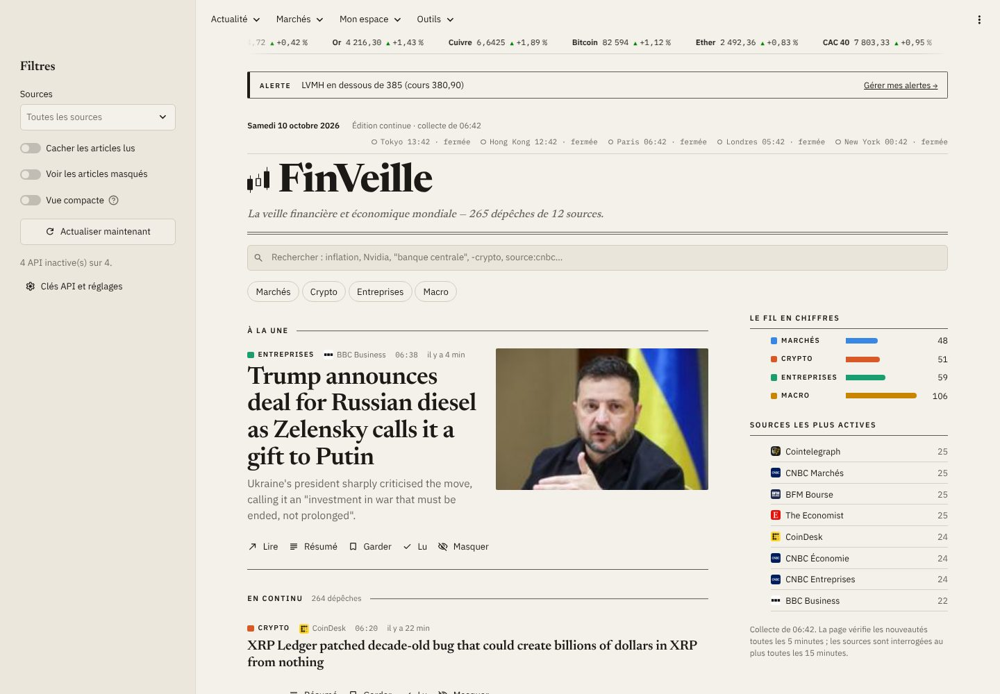

# FinVeille

**La veille financière et économique mondiale, dans une interface de plateforme professionnelle, mise à jour en continu.**

FinVeille rassemble l'actualité de 12 flux RSS et de 4 API financières, la classe par rubrique, suit les
entreprises et les thèmes de son utilisateur, affiche les cours des marchés mondiaux et résume les articles par IA.
Application web en Python (Streamlit), construite pas à pas : chaque étape est un commit, documenté dans
[`guide/`](guide/README.md).



## Fonctionnalités

| | |
| --- | --- |
| **Agrégation** | 12 flux RSS gratuits (CNBC, BBC, Le Monde, BFM Bourse, The Economist, Fed, BCE, CoinDesk…) + Finnhub, NewsAPI, Marketaux et Alpha Vantage si les clés sont renseignées. Téléchargement en parallèle, dédoublonnage. |
| **Le fil** | « À la une » (l'histoire reprise par le plus de sources) et « En continu », rubriques Marchés / Crypto / Entreprises / Macro (classement par mots-clés), tendances cliquables, filtre par source, recherche avancée (`"expression exacte"`, `-exclure`, `source:cnbc`), vue compacte, mise à jour automatique toutes les 5 minutes. |
| **Le brief** | L'édition du jour rédigée automatiquement : la séance en une phrase, l'histoire la plus reprise de chaque rubrique, les sujets qui montent, l'agenda de mes entreprises, le mot du jour. Téléchargeable en Markdown, **envoyé par e-mail chaque matin** aux abonnés. |
| **Comptes** | Inscription par e-mail et mot de passe (empreinte scrypt, blocage anti-force brute, code de confirmation, mot de passe oublié, connexion qui dure 30 jours), ou connexion avec Google, Facebook et autres comptes (OpenID Connect). Assistant de configuration pour l'administrateur. Chaque utilisateur a ses propres favoris, suivis, portefeuille et alertes ; export et suppression de ses données (RGPD). Sans configuration, mode local à un utilisateur. |
| **Base de données** | SQLite en local ; en ligne, PostgreSQL gratuit (Neon, Supabase) en une ligne de secrets, pour que les comptes survivent aux redémarrages. Mêmes requêtes SQL pour les deux, réserve de connexions, tests exécutés sur les deux bases. |
| **Favoris, lu, masqué** | Enregistrés dans une base SQLite, conservés d'une session à l'autre ; notes personnelles ; export CSV des favoris. |
| **Mes suivis** | Entreprises (recherche par nom) et thèmes, avec un fil dédié pour chacun. |
| **Fiches entreprises** | Logo, cours, graphique interactif (1 mois à 5 ans) avec les dépêches placées sur la courbe, 10 indicateurs clés expliqués (PER, VE/EBITDA, ROE, rendement, bêta…), fourchette sur 52 semaines, agenda (résultats, dividende, consensus). |
| **Marchés** | Bandeau défilant des cours sur toutes les pages ; 20 instruments mondiaux avec mini-courbes et carte des performances ; carte du CAC 40 par secteur (40 valeurs, palmarès) ; convertisseur de devises. |
| **Économie** | Tableau de bord des statistiques officielles (BCE, Réserve fédérale) : inflation et inflation sous-jacente, taux directeurs et taux réels, taux à 10 ans, chômage, croissance, pour la zone euro, la France et les États-Unis ; courbes des taux avec détection d'inversion. |
| **Crypto** | Les 20 premières cryptomonnaies en euros (CoinGecko) avec variations et mini-courbes, capitalisation totale, dominance du bitcoin, indice « peur et avidité » sur un an, dépêches crypto. |
| **Comparer** | Jusqu'à 4 entreprises en base 100, rendement annualisé, volatilité, perte maximale, valorisation, matrice de corrélation et **frontière efficiente** de Markowitz (4 000 répartitions simulées, portefeuilles de variance minimale et de Sharpe maximal). |
| **Portefeuille virtuel** | Positions multidevises valorisées en euros, plus-values latentes, répartition, performance comparée au CAC 40, portefeuille d'exemple. |
| **Simulateurs** | Épargne à intérêts composés (frais, règle de 72), investissement programmé rejoué sur l'historique réel d'un indice ou d'une action, crédit immobilier (mensualité, amortissement, taux d'endettement, capacité d'emprunt à 35 %), inflation et rendement réel. |
| **Alertes** | Seuils de cours ou de variation du jour, bandeau d'alerte sur toutes les pages, **e-mail** dès qu'une alerte se déclenche (une fois par jour au plus). Envois par une tâche planifiée GitHub Actions et SMTP (Gmail, Brevo). |
| **Quiz** | 10 questions tirées du glossaire (pièges de la même rubrique), correction détaillée, meilleur score enregistré dans le compte. |
| **Glossaire** | 55 termes de la finance expliqués simplement, recherche, mot du jour. |
| **En chiffres** | Tableau de bord du flux : dépêches par heure et par rubrique, entreprises les plus citées, tonalité par rubrique. |
| **Résumé par IA** | « L'essentiel » en 3 points : Gemini ou Groq (offres gratuites) en français, ou résumé extractif local sans clé ; repli automatique en cas d'erreur, résumés mis en cache. |
| **Apparence** | Thèmes clair et sombre (bleu nuit) avec une palette propre à chacun (`light-dark()` en CSS), cartes, tableaux de données, responsive ordinateur / mobile, contrastes vérifiés par un test automatique, couleurs adaptées au daltonisme. |

## Aperçu

| Le fil (thème sombre) | Le brief du jour |
| --- | --- |
|  |  |
| **Économie (BCE, Fed)** | **Crypto** |
|  |  |
| **Carte du CAC 40** | **Frontière efficiente** |
|  |  |
| **Simulateur d'investissement programmé** | **Portefeuille virtuel** |
|  |  |
| **Fiche entreprise** | **Mobile** |
|  |  |

## Architecture

```
 Navigateur (ordinateur / mobile)
        │
 ┌──────▼─────────────────────────────────────────────────────────────┐
 │ Interface Streamlit   app.py · views/*.py · ui.py · theme.py         │
 └──────┬─────────────────────────────────────────────────────────────┘
        │ appelle                                   (aucun code Streamlit en dessous)
 ┌──────▼─────────────────────────────────────────────────────────────┐
 │ core/  sources → aggregator → classifier · filters · analytics       │
 │        market · summarizer · storage                                 │
 └──┬──────────────────┬──────────────────┬──────────────────┬───────┘
    ▼                  ▼                  ▼                  ▼
 RSS, Finnhub,     Yahoo Finance,     Gemini / Groq     SQLite (local) ou
 NewsAPI, Marketaux, BCE, FRED,       (résumés)         PostgreSQL (en ligne)
 Alpha Vantage     CoinGecko
```

- **Logique et affichage séparés :** `core/` ne dépend pas de Streamlit. Tout y est testable sans navigateur.
- **Un format unique :** chaque source est convertie en `Article` dès la réception.
- **Robustesse :** une source en panne n'arrête jamais l'application ; les erreurs affichées ne révèlent jamais une
  clé API.
- **Sobriété :** caches calibrés sur les quotas gratuits (15 min pour les actualités, 2 min pour les cours, 6 h pour
  les fiches), résumés calculés une seule fois.

## Stack

Python 3.11+ · Streamlit (+ OpenID Connect) · requests · feedparser · yfinance · pandas · NumPy · Altair · trafilatura ·
SQLite / PostgreSQL (psycopg) · pytest

22 étapes documentées dans [`guide/`](guide/README.md), une par commit.

## Lancer le projet

```bash
git clone <adresse-du-dépôt> && cd finveille
python -m venv .venv
source .venv/bin/activate            # Windows : .venv\Scripts\Activate.ps1
pip install -r requirements.txt
streamlit run app.py
```

L'application fonctionne **sans aucune clé**. Pour activer les API et le résumé par IA, copie
`.streamlit/secrets.toml.example` en `.streamlit/secrets.toml` et renseigne les clés gratuites voulues.

Tests :

```bash
pip install -r requirements-dev.txt
pytest
```

## Structure

```
app.py            point d'entrée : thème, bandeau des cours, navigation
ui.py             éléments partagés : chargement en cache, carte d'article, résumé
theme.py          design : jetons de couleur clair/sombre, cartes, tuiles, tableaux, mise en forme française
assets/           le logo (SVG)
views/            une page par fichier (fil, brief, en chiffres, marchés, économie, crypto, comparer, suivis, portefeuille,
                  alertes, favoris, simulateurs, quiz, glossaire, réglages, mon compte)
core/             logique métier : sources, agrégation, classement, statistiques, marché, indicateurs de
                  risque, portefeuille, alertes, brief, économie (BCE, FRED), crypto, simulateurs, quiz, résumé, e-mails,
                  stockage
tests/            164 tests pytest (dont 13 sur PostgreSQL, si une base de test est fournie) (sources, recherche, base et comptes, résumé, indicateurs, portefeuille, alertes,
                  brief, chaque page)
scripts/          tâche planifiée : envoi du brief et des alertes par e-mail
guide/            le guide de construction, étape par étape
```

## Choix de conception

- **Un design de plateforme financière** : barre d'application avec logo, cartes, tableaux, chiffres en police à
  chasse fixe, une seule couleur de marque (le bleu). Interface en IBM Plex Sans, titres d'articles en Newsreader
  pour garder une touche éditoriale. La couleur des données est réservée à la hausse, la baisse et aux rubriques.
- **Deux vraies palettes** : Streamlit indique le thème actif au navigateur (`color-scheme`), la fonction CSS
  `light-dark()` choisit la bonne couleur sans relancer le script.
- **Accessibilité :** contraste WCAG vérifié par un test (texte ≥ 7:1, boutons ≥ 4,5:1, dans les deux thèmes),
  palette validée pour les principales formes de daltonisme, jamais d'information portée par la seule couleur
  (▲/▼ et signes, noms de rubrique), tableau de données à côté de chaque visualisation, animations désactivées si le
  système le demande.
- **Sécurité :** HTML systématiquement échappé, liens non web refusés, requêtes SQL paramétrées, clés dans les
  secrets et transmises par en-tête HTTP quand l'API le permet.

## Limites connues

- Les cours Yahoo Finance sont différés et la bibliothèque yfinance n'est pas officielle.
- La tonalité est estimée par un lexique simple (inspiré de Loughran et McDonald) : elle ne comprend ni la négation
  ni l'ironie.
- Hébergée gratuitement sans `DATABASE_URL`, la base SQLite est réinitialisée au redémarrage du serveur : en ligne,
  configure une base PostgreSQL gratuite (guide, étape 20).

*Projet personnel et pédagogique. Les informations affichées ne constituent pas un conseil en investissement.*
