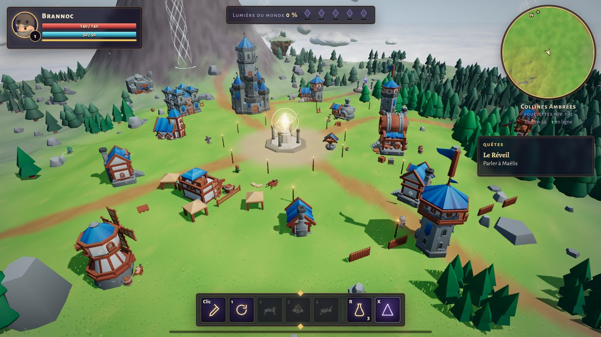
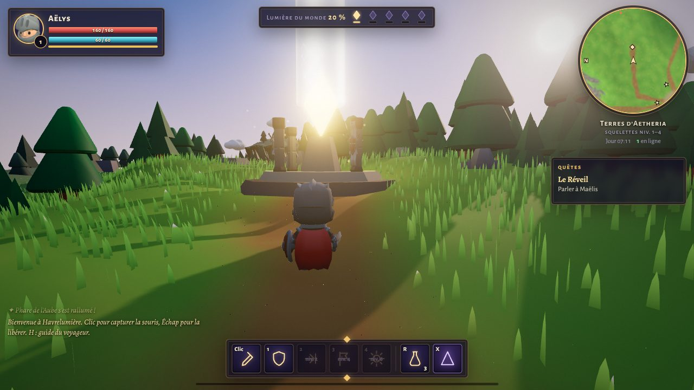
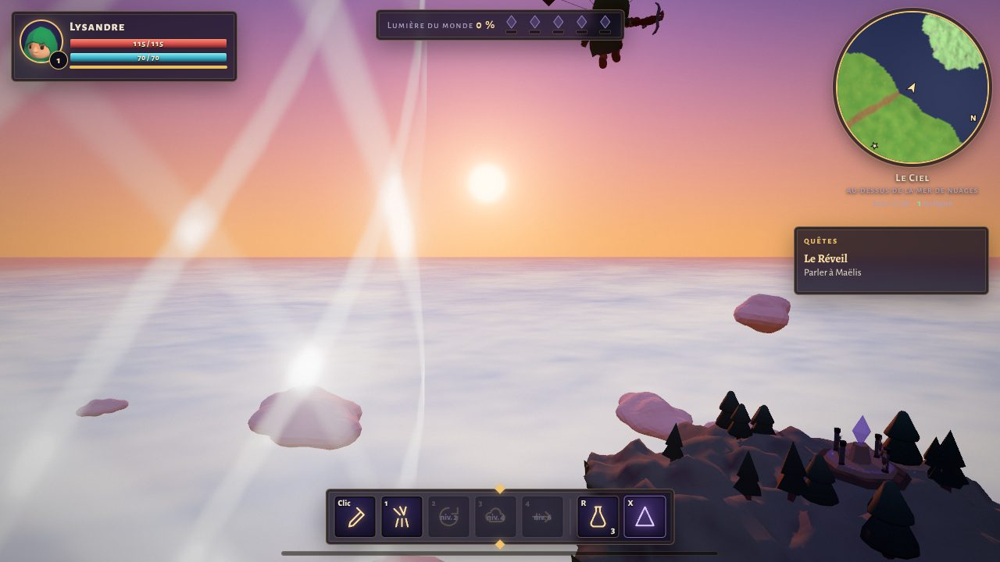
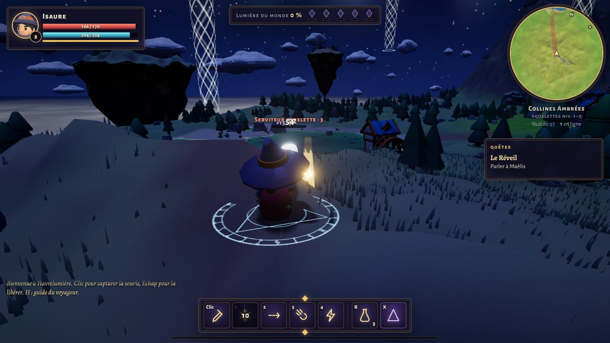

# Aetheria — L’Archipel des Échos

Un MMO 3D qui tourne entièrement dans le navigateur. Au-dessus d’une mer de nuages, une Brume violette relève les morts en squelettes. Les joueurs rallument ensemble cinq Phares, tracent des runes à la souris ou au doigt pour lancer leurs sorts, et discutent avec des habitants qui répondent vraiment, grâce à Claude.

**Jouer :** [Aetheria sur claude.ai](https://claude.ai/artifact/U4r2fFJdTL7Sb6eVSLEnpc) (le lien doit être partagé depuis le menu *Partager* de la page pour que d’autres joueurs puissent entrer).



## Ce qui rend Aetheria différent

| Idée | Ce que ça change |
| --- | --- |
| **Un monde qui se souvient, partagé par tous** | Les cinq Phares sont un objectif commun à tous les joueurs. Chaque squelette vaincu près d’un phare, chaque rune *Lux*, chaque canalisation lui rend de la lumière. La lumière s’éteint lentement **en temps réel** (10 à 18 h) : le monde a besoin de ses héros. Quand un phare atteint 100 %, tous les joueurs voient la Brume reculer, l’herbe reverdir et les fleurs repousser. |
| **La magie des runes dessinées** | Maintenez le clic droit et tracez une forme d’un seul geste : triangle (*Ignis*, boule de feu), éclair (*Fulgur*, foudre en chaîne), cercle (*Vita*, soin de groupe), V (*Aegis*, bouclier), spirale (*Ventus*, propulsion dans les airs), trait vertical (*Lux*, rayon qui nourrit les phares). Un algorithme de reconnaissance de gestes ($P Point-Cloud) mesure la précision du tracé : plus il est juste, plus le sort est puissant. |
| **Des habitants qui pensent** | Maëlis, Brom, Sir Aldric, Lysa et l’Oracle des Échos répondent librement à ce que vous leur dites (via Claude), dans leur caractère, en connaissant l’état du monde, votre progression et vos quêtes. Ils se souviennent de vos échanges. L’Oracle invente des quêtes uniques, validées et récompensées par le jeu. Sans IA disponible, un repli scénarisé prend le relais. |
| **Les Échos** | Gravez des messages dans le monde pour les autres joueurs (« Attention : une embuscade droit devant »). Ceux qui les trouvent utiles les font résonner. Quand un héros tombe, une tache rouge marque l’endroit : en l’approchant, on revoit son fantôme rejouer ses dernières secondes. |
| **Vrai multijoueur, sans serveur dédié** | Chaque joueur publie son état complet dans une salle temps réel. Le joueur le plus ancien devient l’hôte et simule les squelettes pour tout le monde ; s’il part, un autre reprend la main sans perdre la partie. |
| **Voler entre les îles** | Double saut pour ouvrir la paravoile, colonnes de vent visibles de loin pour gagner de l’altitude, îlots flottants avec coffres célestes et un phare perché au-dessus des nuages, anneaux de vent à traverser en planant. |
| **Expéditions entre amis** | Menu *Multijoueur* (touche P) : un joueur héberge, le jeu crée une salle privée et affiche un code à 5 lettres ; jusqu’à trois amis le tapent pour rejoindre. Le groupe part dans la **Citadelle des Ombres** (gardes, autels à purifier, braseros à allumer, puis la Sentinelle, la Liche et l’Avatar de la Brume) ou dans l’**Arène des Champions** (les trois seigneurs à la suite). Difficulté adaptée au groupe, rejouable plus dur. |



## Contenu

- **4 classes** jouables (Chevalier, Barbare, Mage, Rôdeuse), 16 compétences débloquées au fil des niveaux. **L’attaque de base est automatique** : le héros frappe ou tire seul sur l’ennemi le plus proche, le joueur se concentre sur les compétences et les runes (désactivable dans les options).
- **Monture d’éther** : un cerf spectral invoqué hors combat (touche N ou bouton cerf) pour galoper à travers l’archipel ; on saute de son dos pour ouvrir la paravoile.
- **38 types d’ennemis** : squelettes de l’archipel, pillards d’ambre, squelettes de givre qui ralentissent, et les **créatures de la Brume** modélisées et animées par le jeu (gelées qui se divisent, araignées, loups, golems à onde de choc, feux follets, et leurs variantes d’ambre et de givre), goules, revenants, banshies, spectres et loups-garous des Landes Spectrales, druides, panthères et golems moussus de la Canopée, dont des élites dorées ; **5 boss du monde** (*le Roi Sans Lumière*, *le Colosse d’Ambre*, *la Reine de Givre*, *le Gardien Sylvestre*, *le Fossoyeur*) et **3 boss d’expédition**, avec une bibliothèque d’attaques annoncées au sol (charges, séismes, météores, blizzard, téléportations, salves…). Leurs points de vie s’adaptent au nombre de joueurs.
- **25 quêtes principales**, **plus de 50 quêtes secondaires** réparties chez 17 habitants (récolte, exploration, chasse, élites, runes, anneaux de vent, pierres de passage…), et des quêtes infinies générées par l’Oracle. Un **losange doré à l’écran** guide toujours vers l’objectif suivi, avec la distance. Chaque objectif s’ouvre sur un **tutoriel « Comment faire ? »** adapté au PC ou au mobile.
- **Vagues de la Brume** : de temps en temps, une faille s’ouvre près des héros et lâche trois vagues de monstres de la région ; chaque héros présent à la fin reçoit un coffre.
- **Coffres** en bois, de fer, dorés et mythiques : 35 coffres cachés dans le monde (forêt, ruines, îlots, sommets), lâchés par les boss et les élites, ou achetés. L’ouverture se fait **façon roulette** : une bande d’objets défile puis ralentit sur le gain, avec les probabilités de chaque rareté affichées et un légendaire garanti au bout de 35 coffres.
- **Cinq raretés** (commun, rare, épique, légendaire, mythique avec vol de vie). Plus c’est rare, plus c’est fort, mais avec mesure (environ +30 % de dégâts pour un mythique face à un commun), et un objet d’un niveau supérieur est ramené au niveau du héros.
- **Quatre emplacements de sauvegarde** et retour à l’accueil depuis les options pour changer de héros.
- **Récolte** : fleurs d’aube, mousses d’argent, plumes des nuées, éclats d’ambre et cristaux de givre se ramassent en marchant dessus.
- **Butin** remodélisé (piles de pièces, fioles, petits coffres, objets avec halo et colonne de lumière selon la rareté), amélioration d’armes chez le forgeron, élixirs et coffres chez la marchande.
- **Monde** (environ 3 km de côté) : une île principale de près de 800 m de large (village, hameau des Prés-Bas, lac, forêt, ruines, falaises, montagne), quatre grandes îles — les **Terres d’Ambre** (mesas, gorge, mine, cirque, cactus), les **Cimes de Givre** (lac gelé, sanctuaire, mont enneigé), la **Canopée d’Émeraude** (jungle géante, lac, temple englouti, Mont Feuillu) et les **Landes Spectrales** (grand cimetière, crypte, marais, Mont des Corbeaux) — reliées par treize ponts de corde et treize îlots flottants. Les colonnes de vent naissent toujours d’un socle runique posé au sol. **Pierres de passage** pour voyager instantanément, carte interactive (zoom, déplacement), cycle jour/nuit synchronisé sur l’heure réelle, aurores boréales, lucioles, neige et poussière d’ambre selon la région.
- **Audio 100 % procédural** : musique générative qui change entre le jour, la nuit, le combat et le boss ; bruitages synthétisés en temps réel ; vent, oiseaux et grillons.
- **Verrouillage de cible** : Tab sur PC, bouton « cible » ou une tape sur l’ennemi sur mobile ; la caméra suit la cible et passe à la suivante quand elle tombe.
- **Options** : champ de vision, distance et secousses de caméra, chiffres de dégâts, noms des ennemis, attaque automatique, taille des boutons tactiles, vibrations, compteur d’images.
- **Mobile** : joystick flottant (sous le pouce, n’importe où à gauche), caméra qui se replace derrière le héros quand il court, ciblage tolérant, boutons d’action en arc, tracé des runes au doigt, mise en page adaptée au portrait et au paysage.
- **Collisions précises** : les contours au sol des bâtiments, arbres, rochers et décors sont calculés depuis la géométrie réelle des modèles ; on peut monter sur les obstacles bas, mais plus traverser les murs.



## Commandes

| Action | Clavier / souris | Tactile |
| --- | --- | --- |
| Se déplacer | ZQSD ou WASD | pouce n’importe où à gauche |
| Regarder | souris (cliquer pour capturer, Échap pour libérer) | glisser sur l’écran |
| Attaquer | automatique (ou clic gauche) | automatique (ou bouton épée) |
| Monture d’éther | N | bouton cerf (menu de gauche) |
| Compétences | 1 · 2 · 3 · 4 | boutons en arc |
| Tracer une rune | clic droit maintenu (ou X) | bouton rune, puis dessiner |
| Sauter · paravoile | Espace · Espace en l’air | bouton saut |
| Sprint · esquive | Maj · C | pousser le joystick au bord · bouton esquive |
| Élixir de vie | R | bouton élixir |
| Parler, canaliser un phare, ouvrir un coffre | E | bouton « Interagir » |
| Discuter · graver un écho · saluer | Entrée · T · G | bouton bulle |
| Carte · sac · quêtes · légendes · guide | M · I · J · K · H | boutons à gauche |
| Multijoueur · expéditions | P (ou bouton « Expéditions ») | bouton groupe |
| Verrouiller une cible · suivante | Tab | bouton « cible » ou toucher l’ennemi (appui long : libérer) |

## Lancer le projet

```bash
npm install
npm run dev            # http://localhost:5173
```

- **Multijoueur local** : ouvrez le jeu dans plusieurs onglets du même navigateur, ils se voient automatiquement. Les expéditions marchent aussi entre onglets (héberger dans l’un, rejoindre avec le code dans l’autre).
- **Multijoueur sur votre propre serveur** : `npm run relay` (port 8787, relais WebSocket sans dépendance), puis ouvrez le jeu avec `?server=ws://votre-hote:8787`. Chaque groupe d’expédition y a sa propre salle.
- **Raccourcis de test** : `?play=mage` saute l’écran titre, `?q=low|medium|high|ultra` force la qualité graphique.

### Construire

```bash
npm run build            # pré-calcule le relief (public/assets/terrain.bin) puis site statique dans dist/
npm run build:apk        # application Android hors-ligne (voir android/README.md)
npm run build:artifact   # page unique dans artifact/ pour claude.ai (modèles 3D publiés en base64)
```

Sur claude.ai, la page déclare les capacités `room` (salle temps réel), `db` (Phares, échos, fantômes, classement, sauvegardes), `user` (identité) et `sample` (Claude pour les habitants). Chaque joueur n’écrit que dans ses propres documents (règles `{self}`). Hors de claude.ai, le jeu fonctionne en solo avec sauvegarde locale, en multi-onglets, ou via le relais WebSocket.

## Architecture

```
src/
  main.js               démarrage, écrans, reprise à chaud après mise à jour
  config.js             monde, classes, ennemis, phares, zones
  engine/               rendu (bloom, étalonnage, 4 qualités), entrées, audio procédural, chargement des modèles
  world/                îles flottantes, ciel jour/nuit, mer de nuages, lac, herbe GPU, forêts, village, phares, colonnes de vent
  entities/             personnage animé à deux couches (haut/bas du corps), joueur, caméra, squelettes, autres joueurs
  game/                 combat, compétences, runes ($P), butin, quêtes, PNJ, échos, état partagé du monde, boss, sauvegarde
  net/                  plateforme Claude, transports (salle, onglets, WebSocket), synchronisation par présence
  ai/Mind.js            dialogues libres et quêtes de l'Oracle via Claude, avec repli scénarisé
  ui/                   HUD, minicarte, fenêtres, dialogues, discussion, commandes tactiles, icônes rendues en 3D
server/relay.mjs        relais WebSocket minimal
tools/build-assets.mjs  pipeline des modèles KayKit (fusion des animations, quantification : 37 Mo → 6,8 Mo)
tools/make-artifact.mjs construction de la page claude.ai
```

Quelques choix techniques :

- **Rendu des modèles** : le ciel courant est préfiltré en éclairage d’environnement (PMREM, rafraîchi toutes les 2,5 s) ; des cartes métal/rugosité déduites des atlas KayKit font briller l’acier et l’or des armures et des armes ; un liseré de lumière (soleil le jour, lune la nuit) détache les silhouettes ; ombres douces et ombre de contact sous chaque personnage.
- **Personnages** : les morceaux de chaque modèle sont fusionnés au chargement en un seul maillage animé et une bibliothèque d’animations unique (76 clips) est partagée par tous les personnages. Chaque animation est découpée en deux couches pour attaquer en courant.
- **Décors** : forêts et rochers instanciés avec un tri par instance à chaque mouvement de caméra (seuls les arbres dans le champ, ou proches pour les ombres, sont dessinés) ; terrain découpé en tuiles ; bâtiments fusionnés par matériau et par case de 64 m.
- **Fluidité** : résolution interne adaptative (baisse dès que les images/s chutent, remonte prudemment), lumières ponctuelles virtuelles limitées aux plus proches, shaders précompilés au chargement.
- **Collisions** : contours convexes calculés en tranchant les triangles des modèles, déplacement par petits pas (pas de traversée des parois fines), dessus praticables pour les obstacles bas.
- **Herbe** : un seul maillage instancié qui s’enroule autour du joueur, hauteur et couleur lues dans des textures du monde, courbée par le vent et les personnages.
- **La Brume** : une carte de corruption recalculée depuis la lumière des phares teinte le sol, l’herbe et les arbres en direct.
- **Simulation** à pas fixes découplée de l’affichage, stable même quand l’image ralentit.

## Crédits

- Modèles 3D : [KayKit](https://kaylousberg.itch.io/) par Kay Lousberg — Character Pack Adventurers, Skeletons, Medieval Hexagon, Dungeon Remastered (licence CC0).
- Moteur 3D : [three.js](https://threejs.org/) (MIT).
- Polices : Uncial Antiqua, Alegreya, Alegreya Sans (SIL Open Font License), via Google Fonts.
- Reconnaissance de gestes : algorithme $P Point-Cloud (Vatavu, Anthony, Wobbrock, 2012), réimplémenté.


